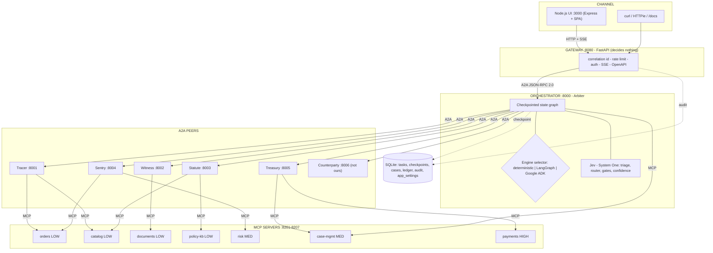
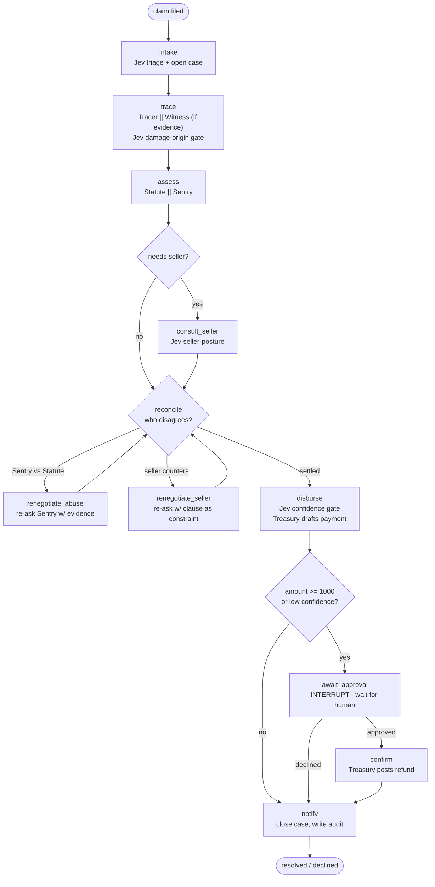
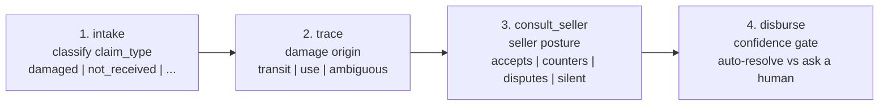
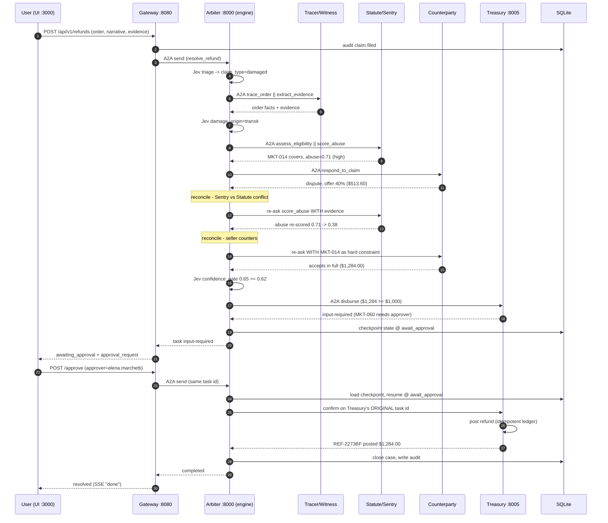
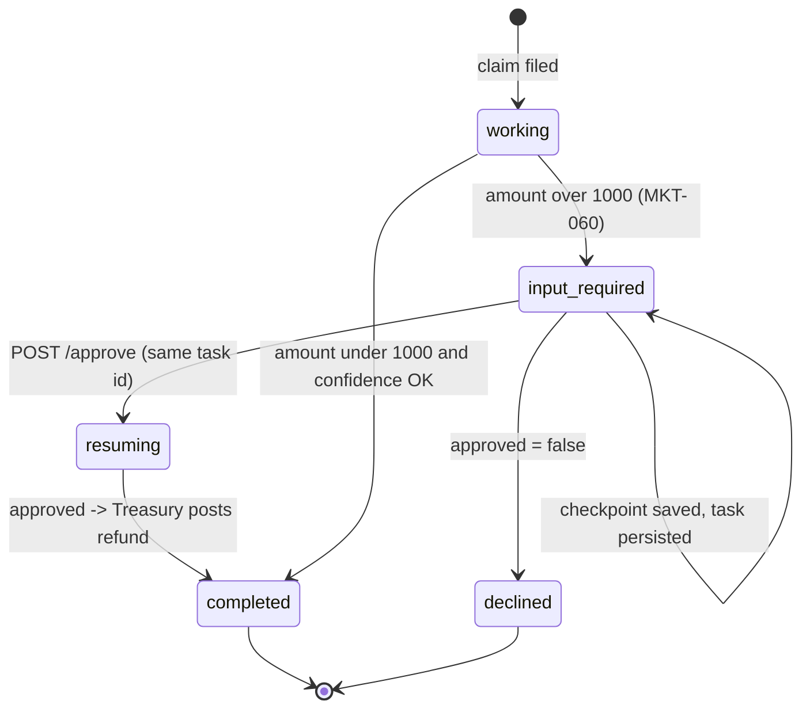
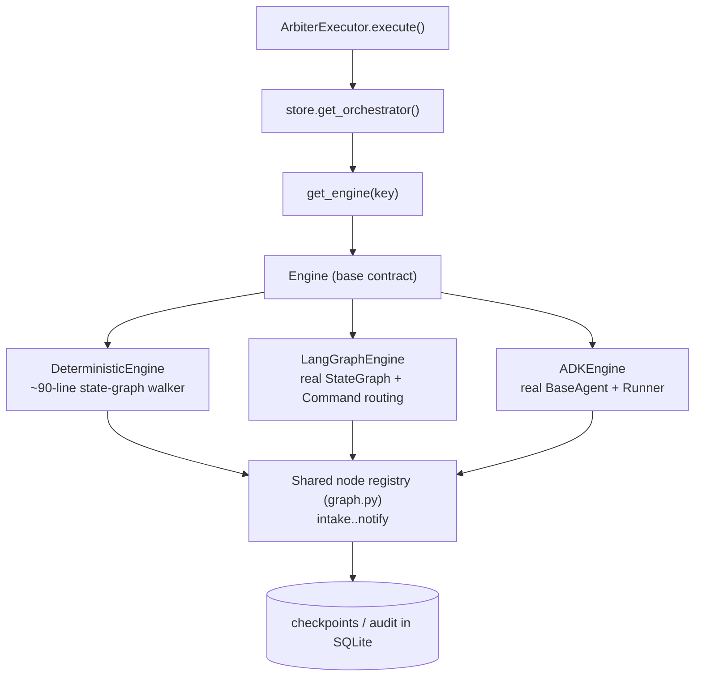
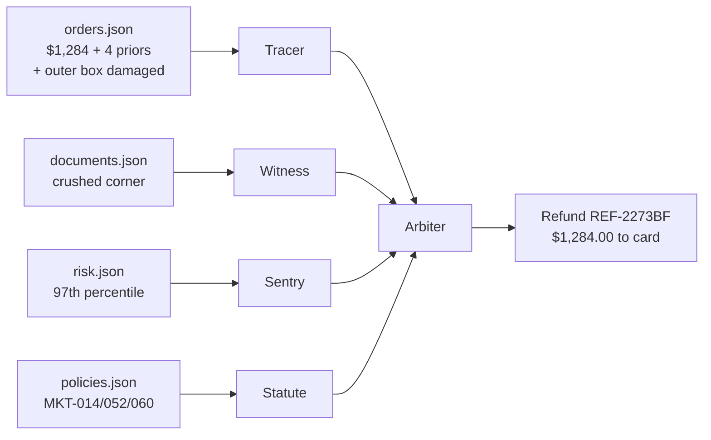
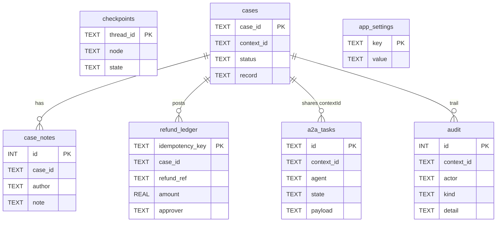
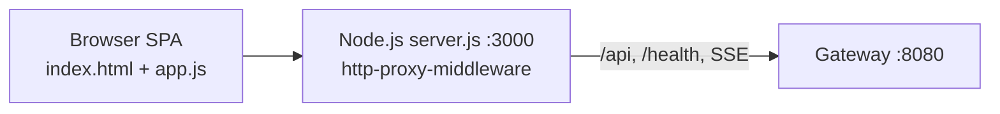

# Refundry — Full Deep Dive (Zero to Hero)

> **One orchestrator. Six agents. Seven MCP servers. One human signature.**
> A runnable refund-resolution network built on **A2A** and **MCP**, with a **System One**
> model (Jev) in the routing path and a **pluggable orchestrator** (deterministic ·
> LangGraph · Google ADK).

This document is the single place to go from *"I've never seen this repo"* to *"I understand
every hop, every decision, and every byte of sample data."* Read it top to bottom.

---

## Table of contents

1. [TL;DR — the 60-second version](#1-tldr--the-60-second-version)
2. [Zero to Hero — the mental model](#2-zero-to-hero--the-mental-model)
3. [Core concepts you must know](#3-core-concepts-you-must-know)
4. [End-to-end architecture](#4-end-to-end-architecture)
5. [The roster — agents & MCP servers](#5-the-roster--agents--mcp-servers)
6. [The orchestration graph (nodes & edges)](#6-the-orchestration-graph-nodes--edges)
7. [The four Jev insertion points](#7-the-four-jev-insertion-points)
8. [End-to-end request flow (sequence)](#8-end-to-end-request-flow-sequence)
9. [The approval interrupt / resume (state)](#9-the-approval-interrupt--resume-state)
10. [Pluggable orchestrator engines](#10-pluggable-orchestrator-engines)
11. [The use case — the $1,284 espresso machine](#11-the-use-case--the-1284-espresso-machine)
12. [Sample data, end to end](#12-sample-data-end-to-end)
13. [State & persistence (SQLite)](#13-state--persistence-sqlite)
14. [The API surface](#14-the-api-surface)
15. [The Node.js UI](#15-the-nodejs-ui)
16. [Zero-to-hero quickstart](#16-zero-to-hero-quickstart)
17. [Repository map](#17-repository-map)
18. [Glossary](#18-glossary)

---

## 1. TL;DR — the 60-second version

A buyer says a **$1,284 espresso machine** arrived with a cracked boiler. The seller says
"pay your own return shipping." The buyer has had **four refunds in ninety days**.

Refundry runs that argument over **real A2A** (agent-to-agent, JSON-RPC 2.0) and **real MCP**
(Model Context Protocol) on your laptop, in about two seconds, with no API keys:

```
User ──▶ FastAPI Gateway ──▶ Arbiter ──A2A──▶ 6 agents ──MCP──▶ 7 servers
                                 │                                   │
                                Jev                            data + tools
                         (triage, routing, gates)
```

The twist: the agents **do not agree**, and the orchestrator **overrules nobody**. When
Sentry (risk) and Statute (policy) conflict, the Arbiter **re-asks Sentry with the evidence
attached** and Sentry re-scores *itself*. When the seller lowballs, the Arbiter **re-asks with
the governing clause as a hard constraint** and the seller accepts. Finally, because the
amount is ≥ $1,000, a **human must sign** before money moves.

You can watch all of this live in a **Node.js dashboard**, and you can choose *which*
orchestrator engine walks the graph — **deterministic (jev:local)**, **LangGraph**, or
**Google ADK** — with the choice saved in **SQLite**.

---

## 2. Zero to Hero — the mental model

Build the picture in five layers. Each layer only knows about the one directly below it.

| Layer | Who | Responsibility | Decides refunds? |
|---|---|---|---|
| **Channel** | Node.js UI, curl, `/docs` | Talk to a human or a script | No |
| **Gateway** (`:8080`) | FastAPI | 1 HTTP request → 1 A2A task; auth, rate limit, SSE, correlation id | **No** |
| **Orchestrator** (`:8000`) | Arbiter + Jev + **engine** | Own the case: classify, route, hold the clock, be the one thing a human talks to | Orchestrates, never overrules |
| **A2A peers** (`:8001-8006`) | 6 specialist agents | Each does *one* job and explains it | Each owns its own verdict |
| **MCP servers** (`:8201-8207`) | 7 tool servers | Plain data/tools behind a protocol boundary | No — they're tools |

**The golden rule:** *the orchestrator holds no copy of the policy.* It cannot read the rule
book — it has no `policy-kb` client. It acts only on what **Statute** tells it. That is why
Legal Ops can ship a clause change without a code review.

**The second golden rule:** *every box above is a real network hop* with a timeout and a
documented behaviour when the peer never answers. Only the *process supervision* is collapsed
into one asyncio process for the demo — the traffic is genuine A2A and MCP over HTTP.

---

## 3. Core concepts you must know

### A2A — Agent-to-Agent protocol
Agents talk to each other over **JSON-RPC 2.0**. Each agent publishes an **Agent Card** at
`/.well-known/agent-card.json` advertising its skills. A unit of work is a **task** with a
lifecycle: `submitted → working → (input-required) → completed | failed`. Tasks are durable
and keep their id across a restart — essential for the four-hour approval wait.

### MCP — Model Context Protocol
Agents reach **data and tools** through MCP servers (stateless, `2026-07-28`). Each server
advertises a **risk tier** (LOW / MED / HIGH). `payments` is the only HIGH-tier server, and it
refuses to move money without a signature.

### Jev — a System One model in the routing path
**Jev** is a small, fast "System One" model that makes **calibrated, low-latency** routing
decisions (classify, branch, gate) — not prose. It runs locally with no API key (the
`jev:local` backend). It is consulted at **four insertion points** (see §7). Each decision
returns a **choice + confidence** or a **noul** (a 0–1 calibrated probability).

### The orchestrator engine (new, pluggable)
*What* each node does is fixed and tested. *How* the graph is walked is an implementation
detail you can swap. Three engines run the **same** node registry and produce the **same**
refund outcome:

- **deterministic · jev:local** — the project's own ~90-line state-graph walker (default).
- **LangGraph** — a real `StateGraph` with dynamic `Command` routing.
- **Google ADK** — a real custom `BaseAgent` driven by the ADK `Runner`.

Your selection is persisted in **SQLite** (`app_settings`) and chosen in the UI header.

---

## 4. End-to-end architecture



**Trust boundary:** Counterparty (`:8006`) represents the **seller's own system**. It is *not
ours* and holds none of our MCP clients — it answers from the seller's point of view.

**Port map (one process per service in production; one asyncio process for the demo):**

| Service | Port | Service | Port |
|---|---|---|---|
| gateway | 8080 | orders | 8201 |
| arbiter | 8000 | catalog | 8202 |
| tracer | 8001 | documents | 8203 |
| witness | 8002 | policy-kb | 8204 |
| statute | 8003 | risk | 8205 |
| sentry | 8004 | case-mgmt | 8206 |
| treasury | 8005 | payments | 8207 |
| counterparty | 8006 | | |

---

## 5. The roster — agents & MCP servers

> Each agent's job is one sentence. **If the job needs a comma, it is two agents.**

### Agents (A2A)

| Agent | Port | Its one job | MCP servers it uses | A2A skill |
|---|---|---|---|---|
| **Arbiter** | 8000 | Own the case: classify, plan, route, hold the clock, be the one thing a human talks to | `case-mgmt` | `resolve_refund` |
| **Tracer** | 8001 | Establish what was bought, shipped, and refunded before | `orders`, `catalog` | `trace_order` |
| **Witness** | 8002 | Turn photos/slips into structured, quotable facts | `documents` | `extract_evidence` |
| **Statute** | 8003 | Rule on which policy governs and cite the clause | `policy-kb`, `catalog` | `assess_eligibility` |
| **Sentry** | 8004 | Score refund-abuse risk and say what it is made of | `risk`, `orders` | `score_abuse` |
| **Treasury** | 8005 | Choose the tender, execute, refuse without a signature | `payments`, `case-mgmt` | `disburse` |
| **Counterparty** | 8006 | Represent the seller, from the seller's own system | *none of ours* | `respond_to_claim` |

### MCP servers (tools/data)

| Server | Port | Scope | Risk tier |
|---|---|---|---|
| `orders` | 8201 | order facts, carrier events, prior refunds | LOW |
| `catalog` | 8202 | SKUs, seller policies, defect signals | LOW |
| `documents` | 8203 | evidence photos → structured facts | LOW |
| `policy-kb` | 8204 | marketplace clauses (MKT-xxx) | LOW |
| `risk` | 8205 | buyer risk profile, percentiles | MED |
| `case-mgmt` | 8206 | case lifecycle, notes | MED |
| `payments` | 8207 | disbursement, idempotent ledger | **HIGH** |

### Every agent is the same five files

```
refundry/agents/<name>/
    card.py        what it advertises on its Agent Card
    service.py     the domain logic — deterministic, no model, unit tested
    agent.py       the framework wiring, where a model would actually reason
    executor.py    the A2A lifecycle, written out in full
    __main__.py    puts it on a port
```

> **`service.py` decides. `agent.py` judges and explains.**

---

## 6. The orchestration graph (nodes & edges)

The Arbiter is a **checkpointed state graph**. Every node mutates one `CaseState` object and
returns the name of the next node. The state is checkpointed after **every** node, so a
restart during a four-hour approval wait resumes at the node it stopped on.



**Node reference** (all in `refundry/agents/arbiter/graph.py`):

| Node | What happens | Network calls |
|---|---|---|
| `intake` | Jev classifies the claim; open the case | `case-mgmt.open_case`, `set_status` |
| `trace` | Tracer always; Witness only if evidence; Jev gates damage origin | A2A: Tracer, Witness |
| `assess` | Statute + Sentry in parallel | A2A: Statute, Sentry |
| `consult_seller` | Ask the seller; Jev classifies their posture | A2A: Counterparty |
| `reconcile` | Decide who (if anyone) disagrees; route | — |
| `renegotiate_abuse` | Re-ask Sentry **with evidence attached**; it re-scores itself | A2A: Sentry (+ `catalog`) |
| `renegotiate_seller` | Re-ask seller **with the clause as a hard constraint** | A2A: Counterparty |
| `disburse` | Jev confidence gate; Treasury drafts the payment | A2A: Treasury |
| `await_approval` | **Interrupt**: forward Treasury's `input-required` onto the Arbiter's task | — |
| `confirm` | Send the approval on Treasury's **original** task id | A2A: Treasury |
| `notify` | Close the case, write the final note and audit | `case-mgmt.*` |

**The two re-asks are the whole point.** The orchestrator overrules nobody — it asks again
with a fuller brief, and the specialist changes its own mind.

---

## 7. The four Jev insertion points

Jev (System One) is consulted at exactly four places. Each is a **gate, not an essay** — a
small labelled decision with a calibrated confidence that *branches the case*.



| # | Where | Decision | Why it matters |
|---|---|---|---|
| 1 | `intake` | `claim_type` | Routes the whole case before any agent wakes |
| 2 | `trace` | `damage_origin` | Transit vs wear — branches evidence handling |
| 3 | `consult_seller` | `seller_posture` | Classifies prose into a branchable posture |
| 4 | `disburse` | `confidence_gate` | A calibrated probability decides auto-resolve vs human sign-off (floor = **0.62**) |

Example Jev outputs (from a real run):

```
jev  system_one.intake   claim_type=damaged     confidence=0.51
jev  damage_origin       transit                confidence=1.00
jev  seller_posture      counters
jev  confidence_gate     0.65 clears the 0.62 floor
```

---

## 8. End-to-end request flow (sequence)

This is the full life of the sample case, from the browser click to the posted refund.



---

## 9. The approval interrupt / resume (state)

The pause is the subtle part. No worker is blocked while a human takes four hours — the state
is **checkpointed** and the task keeps its id.



**How resume works in code:**
1. `await_approval` raises `Interrupt(payload)`; the engine saves `(node, state)` to
   `checkpoints` and returns `input-required`.
2. The gateway surfaces `approval_request` to the UI.
3. On `POST /approve`, the executor `store.load_checkpoint(task_id)` → `(node, raw)`, rebuilds
   `CaseState`, and calls `engine.run(state, start=node, resume={...})`.
4. The case **resumes on the same engine it started on** (recorded in `state.routing.orchestrator`),
   even if the global selection changed meanwhile.

---

## 10. Pluggable orchestrator engines

All three engines implement one contract and walk the **same** node registry:

```python
async def run(state, *, thread_id, start=None, resume=None, max_steps=40) -> RunResult
```



| Engine | Key | Library | How it walks the graph |
|---|---|---|---|
| deterministic | `deterministic` | none | custom `Graph.run` loop; checkpoint after each node |
| LangGraph | `langgraph` | `langgraph` | `StateGraph` with dynamic `Command(goto=...)`, conditional entry from `START`, interrupt → `END` carrying payload |
| Google ADK | `google_adk` | `google-adk` | custom `BaseAgent._run_async_impl` driven by `InMemoryRunner`, yields an `Event` per node transition |

**Selection & persistence:**

```
UI header dropdown
   └─ PUT /api/v1/orchestrator  {"orchestrator":"langgraph"}
        └─ store.set_orchestrator("langgraph")
             └─ SQLite app_settings(key='orchestrator', value='langgraph')
```

The choice survives reloads, gateway restarts, and `make seed` (it's configuration, not case
data, so `store.reset()` leaves it untouched). **Swap SQLite for Postgres and nothing above
changes.** If an engine's optional package is missing, its option is shown disabled and the app
falls back to `deterministic`.

Files: `refundry/agents/arbiter/engines/{__init__,base,deterministic,langgraph_engine,adk_engine}.py`.

---

## 11. The use case — the $1,284 espresso machine

The canonical case, narrated with the data that drives each decision.

| Step | Actor | What it establishes | Driven by |
|---|---|---|---|
| Claim filed | Buyer | "Boiler casing cracked; seller says pay return shipping" | order `NW-7731094` |
| Jev triage | Jev | `claim_type = damaged` (conf 0.51) | the narrative |
| Trace | Tracer | Lumen Pro X1, **$1,284.00**, delivered 9 days ago; **4 prior refunds in 90 days, 3 vs this seller** | `orders` MCP |
| Evidence | Witness | Outer carton crushed at the **same corner** as the internal failure; serial plate matches manifest | `documents` MCP |
| Jev damage-origin | Jev | `transit` (conf 1.00) — consistent with the carrier "outer box damaged" event | evidence facts |
| Statute | Statute | **MKT-014** governs, overrides seller terms; buyer owes nothing; **$1,284 refundable** | `policy-kb` MCP |
| Sentry (1st) | Sentry | Abuse **0.71 (high)** — 97th percentile, recommends manual review | `risk` MCP |
| Counterparty (1st) | Seller | Disputes; offers **40% ($513.60)**, buyer returns at own cost | seller system |
| **Conflict** | Arbiter | Sentry says review; Statute says covered + **MKT-052** (a score is not grounds for denial) | reconcile |
| Sentry (2nd) | Sentry | Re-scores **itself to 0.38** — 3 of 4 priors are one seller's defect pattern (a *seller* signal) | re-ask w/ evidence |
| Counterparty (2nd) | Seller | **Accepts in full** under MKT-014 | re-ask w/ clause |
| Jev confidence | Jev | 0.65 clears the 0.62 floor | gate |
| Treasury | Treasury | **$1,284 ≥ $1,000** → needs a named approver (**MKT-060**) | `payments` MCP |
| **Human** | Approver | `elena.marchetti@northwind` approves | UI |
| Resolved | Treasury | **Refund REF-2273BF posted: $1,284.00 to card** | ledger |

The interesting part: **the orchestrator overruled nobody.** It re-asked, and the specialists
changed their own minds with their own reasoning attached.

---

## 12. Sample data, end to end

All sample data lives in `data/seed/*.json` and is loaded into the MCP servers at runtime.
Here is exactly what each decision reads.

### 12.1 The order (`orders.json` → `orders` MCP, read by Tracer)

```json
{
  "order_ref": "NW-7731094",
  "buyer_ref": "BUY-90211",
  "placed_at": "2026-09-05",
  "delivered_at": "2026-09-19",
  "seller_ref": "SEL-CRESTLINE",
  "seller_is_third_party": true,
  "tender": "card",
  "lines": [
    {"sku": "LUMEN-PRO-X1", "title": "Lumen Pro X1 espresso machine",
     "qty": 1, "unit_price": 1284.00}
  ],
  "carrier_events": [
    {"at": "2026-09-16T08:12:00Z", "event": "accepted at origin facility"},
    {"at": "2026-09-17T22:40:00Z", "event": "in transit - Memphis hub"},
    {"at": "2026-09-18T11:05:00Z", "event": "exception: parcel re-labelled, outer box damaged"},
    {"at": "2026-09-19T09:31:00Z", "event": "delivered, signed for at front desk"}
  ]
}
```

- The **$1,284.00** unit price drives the **MKT-060** approval threshold.
- `seller_is_third_party: true` is why **Counterparty** is consulted.
- The `outer box damaged` carrier event corroborates Jev's `damage_origin = transit`.

### 12.2 Prior refunds (`orders.json` → read by Tracer & Sentry)

```json
[
  {"order_ref": "NW-6620418", "seller_ref": "SEL-CRESTLINE", "at": "2026-08-11",
   "amount": 219.00, "reason": "damaged on arrival"},
  {"order_ref": "NW-6011903", "seller_ref": "SEL-CRESTLINE", "at": "2026-07-28",
   "amount": 189.00, "reason": "damaged on arrival"},
  {"order_ref": "NW-5902244", "seller_ref": "SEL-CRESTLINE", "at": "2026-07-02",
   "amount": 130.00, "reason": "damaged on arrival"},
  {"order_ref": "NW-5510277", "seller_ref": "SEL-NORTHWIND",  "at": "2026-07-21",
   "amount": 74.00,  "reason": "changed mind"}
]
```

**4 refunds in 90 days.** Three are against **SEL-CRESTLINE** ("damaged on arrival"). This is
the crux of the re-score: those three are a **seller defect pattern**, not buyer abuse, so
Sentry re-attributes them — dropping the score from **0.71 → 0.38**.

### 12.3 Buyer risk profile (`risk.json` → `risk` MCP, read by Sentry)

```json
{
  "buyer_ref": "BUY-90211",
  "tenure_days": 1460,
  "orders_lifetime": 87,
  "refunds_90d": 4,
  "refunds_value_90d": 612.0,
  "refund_rate_percentile_90d": 97,
  "linked_accounts": 0,
  "chargebacks_lifetime": 0
}
```

Percentile table: `4 refunds → 97th percentile` (first score), but after re-attributing the
seller's three, the remaining **1 refund → 63rd percentile** (re-score).

### 12.4 The governing clauses (`policies.json` → `policy-kb` MCP, read by Statute)

| Clause | Title | Effect in this case |
|---|---|---|
| **MKT-014** | Damaged on arrival | Guarantee applies, overrides seller terms, **100% refundable**, no return shipping; 30-day window |
| **MKT-052** | Refund abuse | A score is **advisory**, never on its own a ground for denial |
| **MKT-060** | Authorisation threshold | ≥ **$1,000.00** requires a **named approver** shown the clause + risk |

### 12.5 How it flows (data → decision)



---

## 13. State & persistence (SQLite)

Everything durable lives in `data/refundry.db`. **Swap this for Postgres and nothing above it
changes.**



| Table | Holds | Why it exists |
|---|---|---|
| `a2a_tasks` | every A2A task | a task must outlive the process that accepted it |
| `checkpoints` | graph state after every node | resume a 4-hour wait at the node it stopped on |
| `cases` | case record | the case's current truth |
| `case_notes` | human/agent notes | the paper trail |
| `refund_ledger` | posted refunds, **idempotent** | a replayed message never mints a second refund |
| `audit` | every tool call, transition, decision, with a trace id | the whole story, one `contextId` |
| **`app_settings`** | **selected orchestrator** (and future prefs) | survives `make seed`; Postgres-ready |

---

## 14. The API surface

Base path `/api/v1`. OpenAPI docs at <http://127.0.0.1:8080/docs>.

| Method | Path | Purpose |
|---|---|---|
| `POST` | `/refunds` | File a claim → case + A2A task (may return `input-required`) |
| `GET` | `/refunds/{case_id}` | Case record, notes, tasks |
| `POST` | `/refunds/{case_id}/approve` | Answer the approval question (same task id) |
| `GET` | `/refunds/{case_id}/stream` | **SSE** live audit trail |
| `GET` | `/cases` | All cases |
| `GET` | `/trail/{case_id}` | Every A2A + MCP exchange, in order |
| `GET` | `/ledger` | Posted refunds |
| `GET` | `/agents` | Every Agent Card (discovery) |
| `GET` | `/servers` | Every MCP server with risk tier |
| `GET` | `/health` | Gateway health + **selected orchestrator** + options |
| `GET` | `/doctor` | Check all 15 services separately |
| `GET` | `/orchestrator` | Selected engine + all options with availability |
| `PUT` | `/orchestrator` | **Choose the engine** (persisted to SQLite) |

**File a claim + approve (curl):**

```bash
curl -s localhost:8080/api/v1/refunds -H 'content-type: application/json' -d '{
  "order_ref":"NW-7731094","buyer_ref":"BUY-90211",
  "narrative":"It arrived with the boiler casing cracked.",
  "evidence_refs":["case://RFD-48213/evidence/photo-1.jpg"]}' | jq

curl -s -X PUT localhost:8080/api/v1/orchestrator \
  -H 'content-type: application/json' -d '{"orchestrator":"langgraph"}' | jq

curl -s localhost:8080/api/v1/refunds/RFD-48213/approve \
  -H 'content-type: application/json' \
  -d '{"approved":true,"approver":"elena.marchetti@northwind"}' | jq
```

---

## 15. The Node.js UI

A thin **Express** app (`ui/`) that serves a single-page dashboard and **proxies** `/api` +
`/health` (including SSE) to the gateway. See [README_UI.md](./README_UI.md) for full details.



- **File a claim** — submit, watch the live SSE timeline, sign the approval; shows which
  **Orchestrator** resolved the case.
- **Cases** — list + drill into the 62-exchange protocol trail.
- **Ledger** — posted refunds.
- **Network** — `doctor` health, every Agent Card, every MCP server.
- **Header** — live health + the **orchestrator selector** (deterministic / LangGraph / ADK),
  persisted to SQLite.

---

## 16. Zero-to-hero quickstart

**Terminal 1 — backend (15 services):**

```bash
make install                 # venv + deps (incl. langgraph, google-adk), ~20s
make run                     # gateway :8080, arbiter :8000, 6 agents, 7 MCP servers
```

> If the LangGraph / ADK options show "not installed", the backend was launched without the
> venv's site-packages on `PYTHONPATH`. Start it as:
> ```bash
> PYTHONPATH="$PWD/.venv/lib/python3.12/site-packages" .venv/bin/python scripts/run_all.py
> ```

**Terminal 2 — the UI:**

```bash
cd ui && npm install && npm start      # open http://127.0.0.1:3000
```

**Terminal 3 — drive it from the CLI (optional):**

```bash
make demo        # files the sample claim; stops to ask you to approve
make doctor      # checks all 15 services separately
make trail       # replay the protocol traffic
make cards       # every Agent Card, as discovery returns it
make jev         # what the System One layer decided, and how sure it was
make test        # 50 unit tests + 15 against the live network
```

**The full loop:** open the UI → pick an orchestrator → **Submit claim** → watch the timeline →
**Approve spend** → see `REF-2273BF` in the Ledger. Re-run with a different engine; the outcome
is identical.

---

## 17. Repository map

```
agent-mesh-orchestration/
├── refundry/
│   ├── gateway/app.py           FastAPI: the only process a human talks to
│   ├── agents/
│   │   ├── arbiter/
│   │   │   ├── graph.py          the node/edge process (intake..notify)
│   │   │   ├── graph_engine.py   the ~90-line state-graph walker (default engine)
│   │   │   ├── jev_router.py     the 4 Jev insertion points
│   │   │   ├── executor.py       A2A lifecycle; selects + runs the engine
│   │   │   └── engines/          << pluggable orchestrators >>
│   │   │       ├── __init__.py       registry + get_engine() factory
│   │   │       ├── base.py           the Engine contract
│   │   │       ├── deterministic.py  jev:local
│   │   │       ├── langgraph_engine.py
│   │   │       └── adk_engine.py
│   │   ├── tracer/ witness/ statute/ sentry/ treasury/ counterparty/
│   │   └── registry.py
│   ├── servers/                 7 MCP servers (orders..payments)
│   ├── a2a/  mcp/  jev/          the protocol + System One clients
│   ├── models.py                CaseState and friends (Pydantic)
│   ├── store.py                 SQLite: tasks, checkpoints, cases, ledger, audit, app_settings
│   └── config.py                every knob + the port map
├── data/seed/*.json             the sample data (orders, risk, policies, ...)
├── scripts/                     run_all.py, run_one.py, seed.py
├── ui/                          the Node.js dashboard (Express + SPA)
├── tests/                       50 unit + 15 live
├── README.md                    the project narrative
├── README_UI.md                 the UI + orchestrator-selector guide
└── Understand.md                << you are here >>
```

---

## 18. Glossary

| Term | Meaning |
|---|---|
| **A2A** | Agent-to-Agent protocol (JSON-RPC 2.0); agents delegate tasks to each other |
| **Agent Card** | `/.well-known/agent-card.json`; an agent's advertised identity + skills |
| **MCP** | Model Context Protocol; how agents reach data/tools (stateless servers) |
| **Jev** | the System One model in the routing path (calibrated choices, not prose) |
| **noul** | a Jev output that is a single 0–1 calibrated probability |
| **contextId** | the one id that ties a case's tasks, trail and checkpoints together |
| **Arbiter** | the orchestrator agent; owns the case, routes, never overrules |
| **Engine** | the pluggable graph walker: deterministic / LangGraph / Google ADK |
| **Interrupt** | a node pausing for human input; state is checkpointed, task id preserved |
| **Idempotency key** | guarantees a replayed disbursement never mints a second refund |
| **Risk tier** | LOW/MED/HIGH label on each MCP server; `payments` is HIGH |
| **MKT-014/052/060** | marketplace clauses: guarantee / abuse-is-advisory / approval-threshold |

---

*Built on real A2A and real MCP, with a System One model in the routing path and a pluggable
orchestrator — runnable on a laptop, in about two seconds, with no API keys.*
